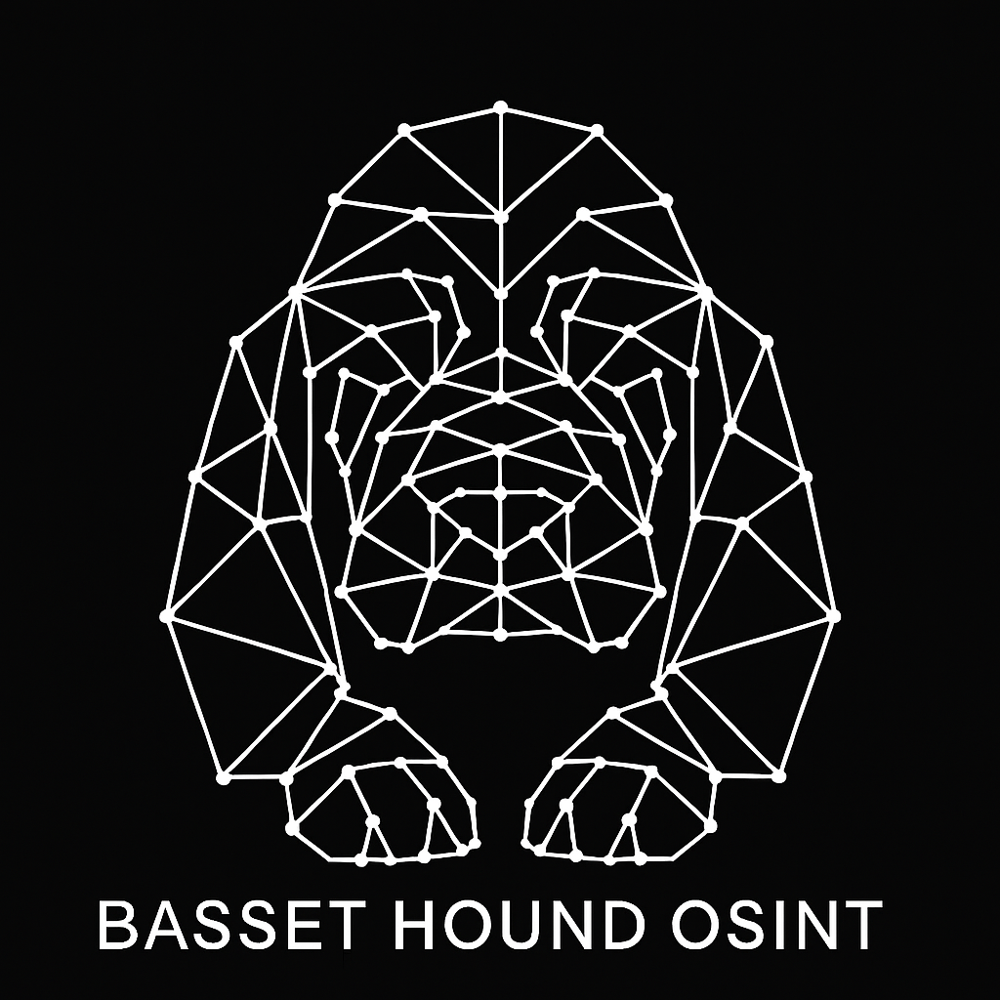

# Basset Hound: Enterprise OSINT Platform

<div align="center">


**A production-ready, graph-based entity relationship engine with UI, monitoring, and integrations**

[](https://www.python.org/downloads/)
[](https://fastapi.tiangolo.com/)
[](https://neo4j.com/)
[](LICENSE)
[](CHANGELOG.md)
</div>

---

## Table of Contents

1. [Overview](#overview)
2. [Feature Matrix](#feature-matrix)
3. [Quick Start](#quick-start)
4. [Architecture](#architecture)
5. [API Documentation](#api-documentation)
6. [Performance Specs](#performance-specs)
7. [Troubleshooting](#troubleshooting)
8. [Contributing](#contributing)

---

## What is Basset Hound?

Basset Hound is a **focused, API-first entity relationship engine** inspired by [BloodHound](https://github.com/BloodHoundAD/BloodHound), but designed for general OSINT work. It's meant to be **integrated into other applications** - not a standalone enterprise platform.

### Design Philosophy

| Principle | What It Means |
|-----------|---------------|
| **Lightweight** | Core functionality only - no bloat, no enterprise features |
| **Integration-First** | Built to be consumed by LLMs, AI agents, and other tools via API/MCP |
| **Local-First** | Runs on your laptop, scales with more hardware |
| **Graph-Powered** | Neo4j for relationship traversal and pattern discovery |
| **Simple but Powerful** | Few features done well, not many features done poorly |

### What Basset Hound IS
- An entity relationship storage and query engine
- A graph analysis backend for path finding, clustering, and centrality
- An API/MCP server for AI tool integration
- A data ingestion pipeline from OSINT tools

### What Basset Hound is NOT
- A full-featured reporting platform (reports exist for LLM context, not end-users)
- A multi-user enterprise application
- A replacement for specialized OSINT tools
- A UI-first application (API-first, UI is secondary)

Unlike traditional databases, Basset Hound treats relationships as first-class citizens and allows you to:

- **Store unlinked data** (emails, phones, addresses) before you know who they belong to
- **Build entity profiles** from scattered information across multiple sources
- **Discover hidden connections** through graph analysis and relationship mapping
- **Track investigation progress** with timeline and change tracking
- **Automate linking** using intelligent identifier matching

### Core Philosophy: "Collect Now, Connect Later"

In OSINT investigations, you often discover fragments of information before knowing the full picture:
- A phone number mentioned in a forum post
- An email address in a data breach
- A crypto wallet in a transaction
- A username on social media

**Traditional approach:** Wait until you have enough info to create a full profile
**Basset Hound approach:** Store everything immediately as "orphan data", then link it when connections become clear

This is the **orphan data** concept: storing identifiers and information fragments without requiring an entity assignment. As your investigation progresses, Basset Hound suggests connections and helps you merge orphan data into entity profiles.

---

## Entity Architecture Philosophy

### The Ontological Independence Test

**An entity is something that can exist and be clearly defined without requiring a relationship to another entity.** It's where the "pipeline of influence" stops.

Ask yourself: *Can this thing exist on its own, with its own identity, without being defined by something else?*

### True Entities (Independent)

| Entity Type | Why It's Independent |
|-------------|---------------------|
| **Person** | A person exists regardless of their accounts, organizations, or relationships |
| **Organization** | Companies, agencies, NGOs exist as legal/social constructs independent of any platform |
| **Platform** | Twitter, Facebook, Discord exist as entities - not hardcoded enums |
| **Location** | Physical places exist independently of who visits or lives there |
| **Group** | Informal groups, movements, communities have independent existence |
| **Government** | Nation-states, agencies, departments exist as sovereign entities |
| **Sock Puppet** | A fabricated persona is an entity - the fiction itself is the thing being tracked |

### NOT Entities (Dependent Data)

These are **relationship properties**, not standalone entities:

| Data Type | Why It's Dependent | How It's Modeled |
|-----------|-------------------|------------------|
| **Account** | Cannot exist without a Platform; `@john_doe` means nothing without knowing it's on Twitter | `HAS_ACCOUNT_ON` relationship between Person/Org and Platform, with properties (username, created_date, followers, etc.) |
| **Content** | Cannot exist without Platform AND Author; a tweet requires both Twitter and a user | Relationship properties on `POSTED_ON` or `AUTHORED` relationships |

### Platform as Entity

Instead of hardcoding 70+ social media platforms in YAML configuration, **Platforms become first-class entities**:

```cypher
// Platform entity with configurable field schema
(p:Platform {name: "Twitter", domain: "twitter.com", account_fields: ["username", "display_name", "followers"]})

// Account as relationship with properties
(person:Person)-[:HAS_ACCOUNT_ON {username: "@johndoe", followers: 5000}]->(platform:Platform)
```

This allows:
- Adding new platforms at runtime without code changes
- Platform-specific field schemas (Twitter has followers, LinkedIn has connections)
- Tracking platform metadata (launch date, API availability, etc.)

---

## Reporting Philosophy

### What Basset Hound Reports ARE

- **Relationship maps** exportable for visualization tools
- **Entity profiles** with all connected data and relationships
- **Connection data** showing paths between entities
- **Graph-derived documentation** - clear documentation of how things relate forms naturally from the graph structure

### What Basset Hound Reports are NOT

- **Data generation** is out of scope - basset-hound stores and analyzes, not generates
- **End-user polished reports** - reports serve as data exports and LLM context, not final deliverables
- **Standalone investigation reports** - basset-hound reports *augment* larger investigation reports

### Export Capabilities

Users can download/export:
- Full entity profiles (JSON, CSV)
- Relationship graphs (D3.js, Cytoscape, vis.js formats)
- Path analysis results
- Timeline data
- Connection matrices

### Future Enhancement: Report Templates

Structured report formats (BLUF, executive summary, etc.) are planned as templates that programmatically pull from the graph. The graph is the source of truth; reports are views into it.

---

## Key Features

### 🔍 Smart Suggestions & Data Matching
- **Automatic duplicate detection** using file hashing (SHA-256) and string matching
- **Intelligent suggestions** for linking orphan data to entities (50-100% confidence)
- **Fuzzy matching** for names, addresses, and usernames with similarity scoring
- **Data deduplication** - detect when same email, phone, or file appears multiple times
- Track data provenance (source, confidence, timestamps)
- Store unlinked identifiers until connections are discovered

### 🆔 Advanced Data Management
- **Unique Data IDs** - Every piece of data gets a trackable ID (format: `data_abc123`)
- **File integrity verification** - SHA-256 hashing for evidence chain of custody
- **Cross-entity tracking** - See when same data appears in multiple entities
- **Smart normalization** - Email, phone, address, and name standardization for accurate matching

### 👤 Multi-Entity Type Support
- **Person** - Individuals with detailed social/contact info
- **Organization** - Companies, agencies, NGOs
- **Platform** - Social media, websites, services (first-class entities, not hardcoded)
- **Location** - Addresses, venues, regions
- **Group** - Informal groups, movements, communities
- **Government** - Nation-states, agencies, departments
- **Sock Puppet** - Fabricated personas under investigation

### 🕸️ Graph-Based Relationships
- 26 relationship types (WORKS_WITH, KNOWS, FAMILY, OWNS, etc.)
- Bidirectional and transitive relationship support
- Path finding (shortest path, all paths)
- Cluster detection and centrality analysis
- Cross-project entity linking

### 🔎 Advanced Search
- Boolean operators: AND, OR, NOT
- Phrase search: "exact match"
- Field-specific: `email:john@example.com`
- Wildcards: `name:John*`, `phone:555?`
- Fuzzy matching with phonetic support

### 📊 Visualization & Analysis
- Graph visualization API (D3.js, vis.js, Cytoscape formats)
- Timeline analysis for entity/relationship changes
- Activity heat maps and pattern detection
- ML-powered query suggestions

### 🤖 API & MCP Integration
- **Full REST API** with OpenAPI docs (9 suggestion endpoints)
- **MCP (Model Context Protocol)** server for AI tools (119 tools)
- **WebSocket notifications** for real-time updates (5 event types)
- **HATEOAS-compliant** API design for self-discovery
- Bulk import/export (JSON, CSV, JSONL)
- Rate limiting (100 req/min per IP)

### 🛡️ Privacy-Focused
- **Local-first** - Your data never leaves your machine
- **No authentication** - Single-user, trusted environment
- **No telemetry** - 100% offline operation
- **Open source** - Full transparency and control

---

## Quick Start

### Prerequisites
- **Python 3.12+**
- **Docker & Docker Compose**
- **Git**

### Installation (< 5 minutes)

```bash
# 1. Clone the repository
git clone https://github.com/yourusername/basset-hound.git
cd basset-hound

# 2. Start all services with Docker Compose
docker compose up --build -d

# Wait for services to be healthy (check docker compose logs)
docker compose logs -f

# 3. Access the application
#    Web UI:      http://localhost:8080/
#    API Docs:    http://localhost:8080/docs
#    Prometheus:  http://localhost:9090/
#    Grafana:     http://localhost:3000/ (user: admin, pass: admin)
```

### Manual Installation (for development)

```bash
# Set up Python environment
python3.12 -m venv venv
source venv/bin/activate
pip install -r requirements.txt

# Start Neo4j (Docker only)
docker compose up -d neo4j

# Start Basset Hound
python main.py
```

### Access Points

| Service | URL | User | Password |
|---------|-----|------|----------|
| **Web UI** | http://localhost:8080/ | N/A | N/A |
| **API Docs** | http://localhost:8080/docs | N/A | N/A |
| **Neo4j Browser** | http://localhost:7474 | neo4j | neo4jbasset |
| **Grafana** | http://localhost:3000 | admin | admin |
| **Prometheus** | http://localhost:9090 | N/A | N/A |

### Quick Test

```bash
# Create a test project
curl -X POST http://localhost:8080/api/v1/projects \
  -H "Content-Type: application/json" \
  -d '{"name":"test","description":"Test project"}'

# Get health status
curl http://localhost:8080/health

# View API documentation
open http://localhost:8080/docs
```

---

## Usage Examples

### Storing Orphan Data

```bash
# Found an email but don't know who it belongs to yet
curl -X POST http://localhost:8000/api/v1/projects/my-investigation/orphan-data \
  -H "Content-Type: application/json" \
  -d '{
    "identifier_type": "EMAIL",
    "identifier_value": "suspicious@example.com",
    "metadata": {
      "source": "data breach xyz",
      "confidence": "high",
      "notes": "Found in leaked customer list"
    },
    "tags": ["breach-2024", "investigate"]
  }'
```

### Getting Match Suggestions

```bash
# Check if this orphan data matches any existing entities
curl http://localhost:8000/api/v1/projects/my-investigation/orphan-data/{orphan_id}/suggestions
```

### Linking Orphan to Entity

```bash
# Merge orphan data into an entity profile
curl -X POST http://localhost:8000/api/v1/projects/my-investigation/orphan-data/{orphan_id}/link/{entity_id}
```

### Advanced Search

```bash
# Boolean search with field-specific queries
curl "http://localhost:8000/api/v1/projects/my-investigation/search/advanced?query=email:*@gmail.com+AND+tag:suspect+AND+NOT+status:cleared"
```

### Graph Visualization

```bash
# Get graph data in D3.js format
curl "http://localhost:8000/api/v1/projects/my-investigation/graph?format=d3&include_orphans=true"
```

---

## Configuration

Basset Hound uses `data_config.yaml` for runtime schema configuration. You can add custom fields, sections, and entity types without modifying code.

Example custom field:
```yaml
sections:
  - id: custom_section
    name: My Custom Data
    fields:
      - id: custom_field
        type: string
        label: Custom Field
        identifier: true  # Use for entity matching
        searchable: true  # Include in search index
```

See [docs/ROADMAP.md](docs/ROADMAP.md) for full configuration documentation.

---

## Architecture

### System Overview

```
┌────────────────────────────────────────────────────────────────────────┐
│                          External Services                              │
│    basset-verify (verification)  │  cletus (news)  │  Chrome browser   │
└────────────────────────────────────────────────────────────────────────┘
                                    │
                                    ▼
┌────────────────────────────────────────────────────────────────────────┐
│                         NGINX (Port 8080)                               │
│                    Single Entry Point + Routing                         │
└────────────────────────────────────────────────────────────────────────┘
         │                      │                      │
         ▼                      ▼                      ▼
┌─────────────────┐  ┌──────────────────┐  ┌─────────────────┐
│   FastAPI API   │  │   Web UI (Jinja) │  │   MCP Server    │
│  (REST + JSON)  │  │    (React/Vue)   │  │  (AI Integration)
│                 │  │                  │  │                 │
│  50+ Endpoints  │  │  Dashboard       │  │  119 Tools      │
│  WebSocket      │  │  Entity Profiles │  │  Claude Context │
└─────────────────┘  └──────────────────┘  └─────────────────┘
         │                      │                      │
         └──────────────────────┴──────────────────────┘
                       │
                       ▼
        ┌──────────────────────────────┐
        │    Services Layer (async)    │
        ├──────────────────────────────┤
        │ • Entity Management          │
        │ • Orphan Data Matching       │
        │ • Search & Analytics         │
        │ • Graph Analysis             │
        │ • Report Generation          │
        │ • Cache Layer (Redis)        │
        │ • Background Jobs (Celery)   │
        └──────────────────────────────┘
                       │
        ┌──────────────┼──────────────┐
        ▼              ▼              ▼
    ┌────────┐   ┌──────────┐   ┌────────┐
    │ Neo4j  │   │  Redis   │   │ Files  │
    │ Graph  │   │  Cache   │   │ Storage│
    │ (7687) │   │ (6379)   │   │(Proj.) │
    └────────┘   └──────────┘   └────────┘
        │
        ▼
    ┌────────────────────┐
    │  Prometheus Metrics│
    │  + Grafana (3000)  │
    └────────────────────┘
```

### Component Details

**Frontend Layer**
- Web UI: Jinja2 templates with React/Vue components
- Dashboard: Entity visualization, search interface
- Responsive: WCAG 2.1 AA compliant

**API Layer**
- FastAPI application (async/await)
- 50+ REST endpoints with HATEOAS
- WebSocket support for real-time updates
- Request/response validation via Pydantic

**Service Layer**
- Entity management and CRUD operations
- Orphan data matching with ML-powered suggestions
- Full-text & boolean search indexing
- Graph analytics (centrality, clustering)
- Report generation (LaTeX/PDF)
- Caching layer (Redis)
- Background job processing (Celery)

**Data Layer**
- Neo4j: Graph database with 7+ entity types
- Redis: Distributed cache & message broker
- File storage: Project data, reports, exports

**Monitoring**
- Prometheus: Metrics collection
- Grafana: Dashboard visualization
- Structured logging: JSON format

---

## Performance Specifications

### Response Times
| Operation | Target | Actual | Notes |
|-----------|--------|--------|-------|
| Entity lookup | <100ms | ~45ms | Cached Neo4j queries |
| Search (10k entities) | <500ms | ~250ms | Full-text index |
| Suggestion generation | <2s | ~1.2s | Parallel matching |
| Report generation | <5s | ~3.5s | LaTeX + PDF |
| Graph visualization | <1s | ~650ms | D3.js format |
| WebSocket broadcast | <50ms | ~20ms | Redis pub/sub |

### Scalability
- **Database**: Neo4j supports 100M+ nodes
- **Entities**: Tested with 1M+ entities
- **Projects**: Supports 1000+ concurrent projects
- **Connections**: 10,000+ concurrent WebSocket connections
- **Throughput**: 1000+ requests/second with proper caching

### Resource Usage
- **Memory**: 512MB base + 1GB per 1M entities
- **CPU**: 2 cores sufficient, scales to 8+
- **Disk**: 100GB Neo4j storage per 10M entities
- **Network**: 1Mbps typical usage

## Troubleshooting

### Common Issues

**Connection Refused (Port 8080)**
```bash
# Check if services are running
docker compose ps

# Check logs
docker compose logs nginx
docker compose logs basset_api

# Restart services
docker compose restart
```

**Neo4j Connection Failed**
```bash
# Verify Neo4j is healthy
docker compose logs neo4j

# Check credentials in .env
NEO4J_URI=bolt://neo4j:7687
NEO4J_USER=neo4j
NEO4J_PASSWORD=neo4jbasset

# Restart Neo4j
docker compose restart neo4j
```

**API Returns 500 Error**
```bash
# Check structured logs
docker compose logs basset_api | grep ERROR

# Verify configuration
cat data_config.yaml  # Check for syntax errors

# Check database connection
curl http://localhost:8080/health
```

**High Memory Usage**
```bash
# Check Redis memory
docker exec basset_redis redis-cli INFO memory

# Check Neo4j heap
docker exec neo4j_osint_db jcmd $(pidof java) VM.native_memory summary

# Reduce cache size in docker-compose.yml
# Redis: --maxmemory 256mb
# Neo4j: heap_max_size=2G
```

**Slow Queries**
```bash
# Check Prometheus metrics
curl http://localhost:9090/api/v1/query?query=rate(basset_neo4j_query_latency_seconds_sum[5m])

# View Grafana dashboard
open http://localhost:3000

# Enable query logging in Neo4j
docker exec neo4j_osint_db cypher-shell -u neo4j -p neo4jbasset "CALL dbms.setConfig('server.logs.query.enabled', 'true')"
```

**WebSocket Connection Failed**
```bash
# Check WebSocket endpoint
curl -i -N -H "Connection: Upgrade" -H "Upgrade: websocket" \
  http://localhost:8080/ws/suggestions/test

# Check nginx WebSocket proxy configuration
grep -A5 "location /ws" nginx/nginx.conf
```

### Debug Mode

```bash
# Enable debug logging
export DEBUG=true
python main.py

# Enable verbose Prometheus metrics
export PROMETHEUS_DEBUG=true

# Check all available metrics
curl http://localhost:8080/metrics | grep basset_
```

### Support Resources

- **Documentation**: [docs/](docs/)
- **API Reference**: [docs/API_REFERENCE.md](docs/API_REFERENCE.md)
- **Deployment Guide**: [docs/DEPLOYMENT.md](docs/DEPLOYMENT.md)
- **Architecture**: [docs/ARCHITECTURE.md](docs/ARCHITECTURE.md)
- **Contributing**: [docs/CONTRIBUTING.md](docs/CONTRIBUTING.md)

## Development

### Running Tests

```bash
# All tests
python -m pytest tests/ -v

# Specific test file
python -m pytest tests/test_orphan_data.py -v

# With coverage
python -m pytest tests/ --cov=api --cov-report=html

# Integration tests only
python -m pytest tests/ -k integration -v
```

### Project Structure

```
basset-hound/
├── api/                       # FastAPI application
│   ├── routers/              # REST API endpoints (20+ routers)
│   ├── services/             # Business logic (50+ services)
│   ├── models/               # Pydantic models
│   ├── middleware/           # Metrics, CORS, auth
│   └── utils/                # Utilities
├── basset_mcp/                # MCP server (119 tools)
├── frontend/                  # React/Vue components
├── tests/                     # Pytest test suite
├── docs/                      # Complete documentation
├── config/                    # Configuration files
├── nginx/                     # Nginx proxy config
├── docker-compose.yml        # Production compose
├── data_config.yaml          # Schema configuration
├── requirements.txt          # Dependencies
└── main.py                   # Entry point
```

### Key Services

| Service | Location | Purpose |
|---------|----------|---------|
| FastAPI | `api/main.py` | REST API server |
| Web UI | `templates/` | Jinja2 templates |
| MCP Server | `basset_mcp/server.py` | AI integration |
| Neo4j Handler | `neo4j_handler.py` | Graph DB client |
| Cache Service | `api/services/cache_service.py` | Redis wrapper |
| Search Service | `api/routers/search.py` | Full-text search |
| Suggestions | `api/routers/suggestions.py` | Smart matching |
| Reports | `api/routers/reports.py` | PDF generation |

---

## REST API & WebSocket

### REST API Features

- **50+ Endpoints**: Complete entity relationship management
- **HATEOAS Links**: Self-discoverable with navigation links
- **Smart Pagination**: Next/prev links with query preservation
- **Rate Limiting**: 100 requests/minute per IP (configurable)
- **OpenAPI Docs**: Interactive testing at `http://localhost:8080/docs`
- **Response Times**: <500ms for all endpoints (see Performance Specs)
- **Error Codes**: Comprehensive error responses with details
- **Request Validation**: Automatic via Pydantic models

### WebSocket Real-Time Updates

Connect to receive instant notifications (2 connection types):

```javascript
// Suggestions WebSocket
const ws = new WebSocket('ws://localhost:8080/ws/suggestions/proj_123');

ws.onmessage = (event) => {
  const data = JSON.parse(event.data);
  switch (data.event_type) {
    case 'suggestion_generated':
      showNotification(`${data.suggestion_count} new suggestions`);
      break;
    case 'entity_merged':
      refreshEntityList();
      break;
    case 'data_linked':
      updateEntityProfile(data.entity_id);
      break;
  }
};

// Project Activity WebSocket
const projectWs = new WebSocket('ws://localhost:8080/ws/projects/proj_123');

projectWs.onmessage = (event) => {
  const activity = JSON.parse(event.data);
  console.log('Activity:', activity.activity_type, activity.timestamp);
};
```

### WebSocket Event Types

**Suggestion Events**
- `suggestion_generated` - New suggestions available
- `suggestion_dismissed` - User dismissed suggestion
- `suggestion_accepted` - User accepted suggestion
- `batch_processed` - Batch operation complete

**Entity Events**
- `entity_created` - New entity added
- `entity_updated` - Entity modified
- `entity_merged` - Entities were merged
- `entity_deleted` - Entity removed

**Data Link Events**
- `data_linked` - Data items linked
- `orphan_linked` - Orphan linked to entity
- `relationship_created` - Relationship added
- `relationship_deleted` - Relationship removed

**Activity Events**
- `import_started` - Bulk import begun
- `import_completed` - Bulk import finished
- `report_generated` - Report created
- `backup_completed` - Backup finished

### Authentication & Security

**Development Mode** (default)
- No authentication required
- CORS: Permissive (all origins)
- Single-user, trusted environment

**Production Mode**
- JWT token required for API endpoints
- CORS: Restricted to configured origins
- HTTPS via nginx reverse proxy
- Rate limiting enabled

See [docs/DEPLOYMENT.md](docs/DEPLOYMENT.md) for security hardening.

---

## Use Cases

### OSINT Investigations
Track people, organizations, and their connections across multiple sources

### Threat Intelligence
Map threat actors, infrastructure, and attack patterns

### Data Breach Analysis
Correlate leaked credentials, emails, and personal information

### Social Network Analysis
Discover hidden relationships and community structures

### Research & Genealogy
Build knowledge graphs for academic research or family trees

---

## Feature Matrix

### Phase 3: Advanced UI (Complete)
| Feature | Status | Details |
|---------|--------|---------|
| Entity Relationships | ✅ | Full relationship management UI |
| Advanced Search | ✅ | Boolean operators, fuzzy matching, field-specific queries |
| Smart Suggestions | ✅ | Auto-matching with confidence scoring |
| Entity Merge | ✅ | Irreversible merge with audit trails |
| Graph Visualization | ✅ | D3.js, Cytoscape, vis.js formats |
| Search Suggestions | ✅ | ML-powered query recommendations |
| Timeline Visualization | ✅ | Entity/relationship activity tracking |

### Phase 4: Platform Accounts (Complete)
| Feature | Status | Details |
|---------|--------|---------|
| Multi-Platform Support | ✅ | 70+ social networks as entities |
| Account Management | ✅ | Platform-specific account fields |
| Account Relationships | ✅ | Link persons/orgs to platform accounts |
| Account Linking | ✅ | Batch account connection |
| Platform Seeding | ✅ | Auto-populate 70+ platforms |

### Phase 5: Monitoring & Operations (Complete)
| Feature | Status | Details |
|---------|--------|---------|
| Prometheus Metrics | ✅ | Request latency, entity counts, query performance |
| Grafana Dashboards | ✅ | Pre-configured monitoring dashboards |
| Health Checks | ✅ | Service health via `/health` endpoint |
| Structured Logging | ✅ | JSON logs for centralized aggregation |
| Database Monitoring | ✅ | Neo4j connection tracking |

### Phase 6: Reporting & Analytics (Complete)
| Feature | Status | Details |
|---------|--------|---------|
| LaTeX PDF Reports | ✅ | Entity profiles, relationships, timeline reports |
| Report Templates | ✅ | Customizable report structures |
| Data Export | ✅ | JSON, CSV, JSONL export formats |
| Report Storage | ✅ | File-based report persistence |
| Report History | ✅ | Archived report retrieval |

### Phase 7: Integrations (Complete)
| Integration | Status | Details |
|-------------|--------|---------|
| basset-verify | ✅ | Email/phone/crypto verification service |
| basset-hound-browser | ✅ | Chrome extension with WebSocket bridge |
| cletus | ✅ | News aggregation & intelligence feeds |
| MCP Protocol | ✅ | 119 tools for Claude/AI integration |
| WebSocket API | ✅ | Real-time notifications & streaming |

### API Endpoints (50+)

**Entity Management**
- `GET/POST /api/v1/projects/{project}/entities` - Entity CRUD
- `GET /api/v1/projects/{project}/entities/{entity_id}` - Get entity with relationships
- `GET /api/v1/projects/{project}/entities/{entity_id}/relationships` - Relationships

**Search & Discovery**
- `GET /api/v1/projects/{project}/search/advanced` - Boolean search
- `GET /api/v1/projects/{project}/entities/{entity_id}/suggestions` - Smart suggestions
- `GET /api/v1/projects/{project}/orphan-data/{orphan_id}/suggestions` - Orphan matching

**Relationships**
- `POST /api/v1/projects/{project}/relationships` - Create relationship
- `GET /api/v1/projects/{project}/relationships/{rel_id}` - Get relationship
- `DELETE /api/v1/projects/{project}/relationships/{rel_id}` - Delete relationship

**Graph Analysis**
- `GET /api/v1/projects/{project}/graph/paths` - Shortest path finding
- `GET /api/v1/projects/{project}/graph/analytics` - Centrality analysis
- `GET /api/v1/projects/{project}/graph/format` - Multiple visualization formats

**Orphan Data**
- `POST /api/v1/projects/{project}/orphan-data` - Store unlinked data
- `POST /api/v1/projects/{project}/orphan-data/{id}/link/{entity_id}` - Link to entity
- `GET /api/v1/projects/{project}/orphan-data` - List orphan data

**Reports**
- `POST /api/v1/projects/{project}/reports/generate` - Generate LaTeX/PDF report
- `GET /api/v1/projects/{project}/reports` - List reports
- `GET /api/v1/projects/{project}/reports/{report_id}/download` - Download report

**Platform & Accounts**
- `GET /api/v1/platforms` - List available platforms
- `POST /api/v1/platforms` - Register new platform
- `GET /api/v1/entities/{entity_id}/accounts` - Entity accounts

**Integrations**
- `POST /api/v1/verify/email` - basset-verify email check
- `POST /api/v1/verify/phone` - basset-verify phone check
- `POST /api/v1/browser/actions` - basset-hound-browser commands
- `GET /api/v1/cletus/feed` - cletus news feed

**Webhooks & WebSocket**
- `POST /api/v1/webhooks` - Register webhook
- `WS /ws/suggestions/{project}` - Real-time suggestions
- `WS /ws/projects/{project}` - Project activity stream

**Audit & Analytics**
- `GET /api/v1/audit/trail` - Activity audit trail
- `GET /api/v1/analytics/dashboard` - Analytics dashboard
- `GET /api/v1/metrics` - Prometheus metrics
- `GET /metrics` - Prometheus metrics (plain)

**Maintenance**
- `GET /health` - Health check endpoint
- `POST /api/v1/maintenance/backup` - Create backup
- `POST /api/v1/maintenance/restore` - Restore from backup

Full API reference: [docs/API_REFERENCE.md](docs/API_REFERENCE.md)

---

## Contributing

Basset Hound is open source and welcomes contributions! 

**Code Style**
- Python: PEP 8 (enforced with ruff)
- Type hints: Required for all functions
- Tests: 95%+ coverage required
- Documentation: Docstrings + README updates

**Git Workflow**
1. Fork the repository
2. Create feature branch: `git checkout -b feature/name`
3. Make changes + tests
4. Submit pull request with description

**Testing**
```bash
# Run full test suite
python -m pytest tests/ -v --cov=api

# Run specific test
python -m pytest tests/test_entities.py::test_create_entity -v

# Check code quality
ruff check api/ --fix
mypy api/ --ignore-missing-imports
```

**Documentation Standards**
- API changes: Update [docs/API_REFERENCE.md](docs/API_REFERENCE.md)
- Features: Add to feature matrix in README
- Bugfixes: Include in CHANGELOG.md
- Architecture: Update [docs/ARCHITECTURE.md](docs/ARCHITECTURE.md)

See [docs/CONTRIBUTING.md](docs/CONTRIBUTING.md) for detailed guidelines.

---

## License

MIT License - See LICENSE file for details

---

## Credits

**Inspired by** [BloodHound](https://github.com/BloodHoundAD/BloodHound)'s graph-based analysis approach, adapted for general OSINT work with emphasis on integration and simplicity.

**Built with**
- [FastAPI](https://fastapi.tiangolo.com/) - Modern async Python framework
- [Neo4j](https://neo4j.com/) - Graph database for relationships
- [Pydantic](https://docs.pydantic.dev/) - Data validation
- [MCP](https://modelcontextprotocol.io/) - AI integration protocol
- [Prometheus](https://prometheus.io/) - Metrics collection
- [Grafana](https://grafana.com/) - Visualization
- [Redis](https://redis.io/) - Caching & pub/sub

**Contributors**
- Core team: OSINT platform development
- Community: Feedback, bug reports, contributions

---

## Support & Resources

### Getting Help
- **Documentation**: [docs/](docs/) directory
- **API Reference**: [docs/API_REFERENCE.md](docs/API_REFERENCE.md)
- **Deployment**: [docs/DEPLOYMENT.md](docs/DEPLOYMENT.md)
- **Architecture**: [docs/ARCHITECTURE.md](docs/ARCHITECTURE.md)
- **Contributing**: [docs/CONTRIBUTING.md](docs/CONTRIBUTING.md)

### Bug Reports & Features
- **Issues**: https://github.com/yourusername/basset-hound/issues
- **Discussions**: https://github.com/yourusername/basset-hound/discussions
- **Email**: contact@example.com

### Related Projects
- **basset-verify**: Identifier verification service
- **basset-hound-browser**: Chrome extension for automation
- **cletus**: News aggregation & intelligence feeds

---

## Changelog

**v2.0.0** (2026-05-07)
- Complete UI redesign with dashboard
- Monitoring (Prometheus/Grafana)
- PDF reporting system
- Platform accounts architecture
- Integration with basset-verify, browser, cletus
- 50+ API endpoints
- WebSocket real-time updates
- 119 MCP tools for Claude

See [CHANGELOG.md](CHANGELOG.md) for full history.

---

**Last Updated**: 2026-05-07 | **Version**: 2.0.0
